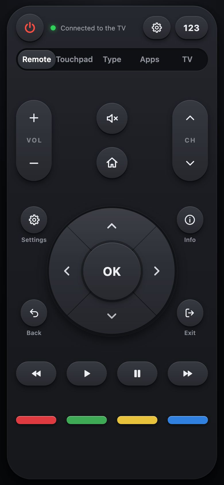
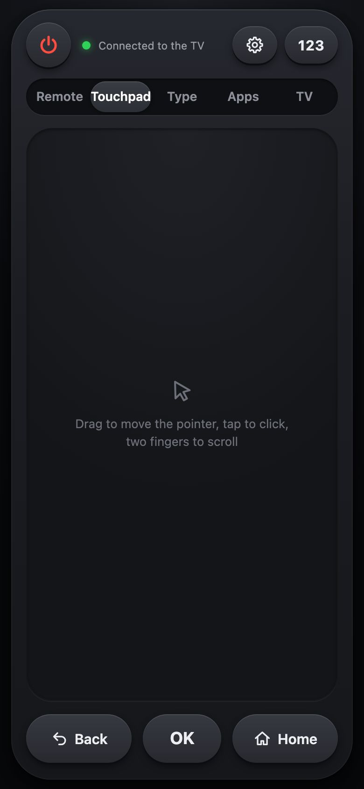
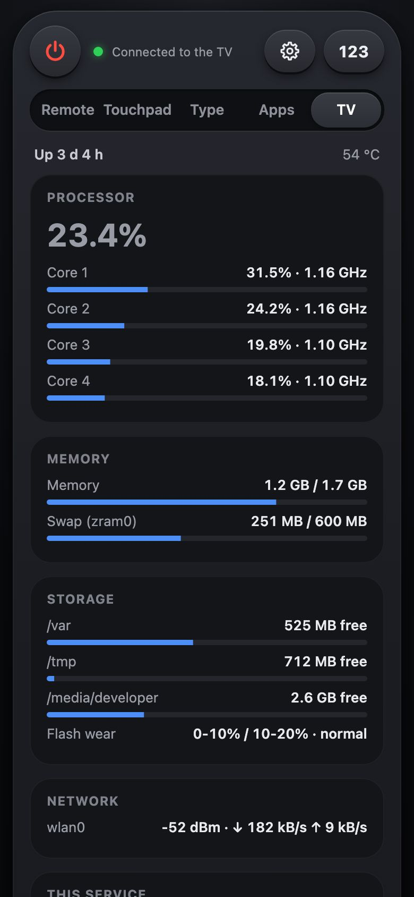
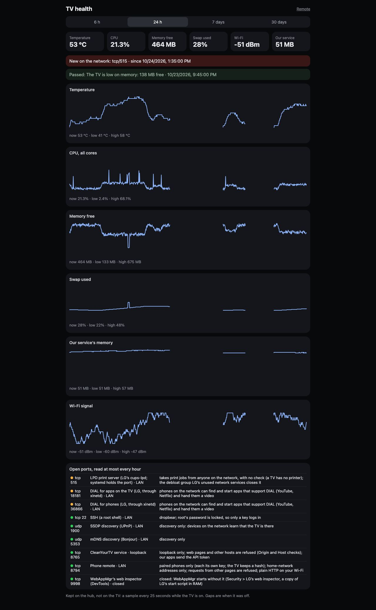
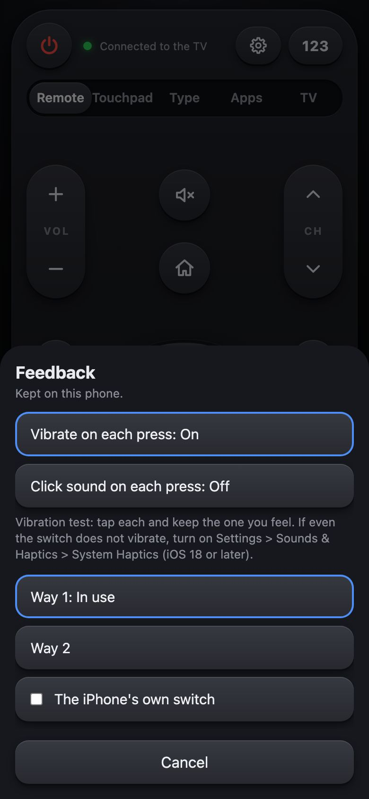

# Phone remote

Your phone, on the same Wi-Fi as the TV, as its remote, laid out like LG's: power, the volume and channel rockers, the arrows round OK,
Back, Home, Settings, Info and Exit, play and pause, the colour keys and a number pad, a touchpad for the pointer, typing into a search
box on the TV, and the apps of your dock. It is off until you pair a phone.

## Pairing a phone

1. On the TV: **Customize** > **Phone remote...** (or the CleanYourTV app > Phone remote) > **Pair a phone**.
2. Scan the QR code with the phone's camera. The remote opens and pairs itself; the code on the TV also works typed in.
3. On the phone: **Add to Home Screen** (Safari's Share menu, or Chrome's menu), so it opens full screen like an app.

The code works for five minutes, and five wrong codes close it. On an iPhone, a remote added to the Home Screen keeps its own storage: open the icon and pair it there too, with a new code (Pair a phone again on the TV). Each phone gets its own key, kept on that phone; the TV keeps only a
fingerprint of it (a SHA-256), so a copy of the TV's settings cannot be used as a key. **Phone remote** in the CleanYourTV app lists
the phones: OK on one removes it, and that phone stops working at once. **Phone remote: Off** stops the remote for every phone without
forgetting them.

| Tab | What it does |
|---|---|
| Remote | Power (asks first, then turns the TV off), the volume rocker (hold to repeat) and Mute, the channel rocker, Home, the arrows round OK (hold one to repeat), Settings, Info, Back and Exit, rewind, play, pause and fast forward, and the red, green, yellow and blue keys. **123** opens a number pad (1 to 9, 0, the dash and OK). Hold OK, Back, Home or Settings for LG's long press, as on the remote (on Home, holding OK opens an app's menu). Hold a colour key to give it an app: a tap then opens that app; **LG's own key** puts it back (Live TV and HbbTV use the colour keys). The choice stays on that phone. |
| Touchpad | Drag to move the pointer (a quick drag goes further, a slow one is precise), tap to click where the pointer is, two fingers to scroll, as with the Magic Remote; Back, OK and Home under it. |
| Type | Text for a search box on the TV: open the box first, the text goes where its cursor is; Delete and Enter. |
| Apps | The apps in the order of your dock, then the others; a tap opens one. |
| TV | The TV's health, read only: the processor per core, temperature, memory and swap, storage and the flash's wear, Wi-Fi, how long it has been up and this service's own use; a summary of the settings (versions, update channel, CleanYourTV as Home, the debloat groups and whether they work, the phone remote, Plex, Stremio and Disney+ linked or not, telnet, LG's web inspector, the API token); and, on a tap, the open ports with how each is guarded and the services. See below. |

| | |
|---|---|
|  |  |

## The TV tab

The tab asks the TV every 3 seconds, only while it is shown and the page is in front, with the phone's own key like every
other command (`GET /status-data`; `/status-exposure` and `/status-services` on a tap). It shows nothing secret: no token, key,
address, MAC, playlist, account or phone name, and a port is only ever "loopback" or "LAN". It changes nothing on the TV and keeps
nothing: the TV makes one reading every 2 seconds at most, whoever asks, and none while nobody looks. A phone that is not paired, or
removed on the TV, gets nothing.

| | |
|---|---|
|  | |

What one look costs on the TV (an 86UR8000, webOS 25, read in place with the service's own code on 2026-10-29): a health reading
about 3.5 ms of processor time (one every 2 s while someone looks: about 0.2% of one core), free space one `df` a minute (about
15 ms); **Top processes** about 75 ms per look at the 330 processes (the first look waits 2 s for its second); **Open ports and
services** 0.2 to 0.4 s, since it looks through about 5 000 open files to find who holds each port (only when opened, kept 30 s);
LG's running services one `systemctl` (about 50 to 100 ms). The service holds about 1 MB more memory for all of it.

### History and alerts: on a computer that stays on

The TV keeps no history. Graphs over hours and alerts (the temperature, a debloat group that stopped working, a new open port)
belong on a computer at home that stays on, not on the TV: that computer pairs once like a phone, keeps its own key, and reads
`/status-data` every 30 to 60 seconds, which costs the TV one reading each time. The always-on helper that serves the phone pages
through your home server reaches the TV tab the same way.

## How it works, and what it can reach

- The page and its commands come from the TV's own service on port **8794**, only while a phone is paired (or pairing is open), and
  only for addresses of the home network. It is plain HTTP on your Wi-Fi, like the other phone pages; no port is opened on your
  router, and nothing goes through the internet.
- Every command carries the phone's key. Another web site open on the phone cannot send commands (the TV refuses requests from other
  pages), and the page cannot be shown inside another site.
- The keys go to LG's own network input: the keys LG names (Home, Back, OK, Exit, the gear key's quick settings) by name, the arrows
  and the rest by their key code; text goes to LG's on-screen keyboard. The volume and Mute go to LG's audio service, as the TV's own
  volume does, so a soundbar on HDMI eARC follows them (network input's volume keys did not reach one). The remote presses only what
  you tap: nothing here changes the TV or its volume by itself.
- The touchpad moves, clicks and scrolls LG's pointer through its pointer input (each message framed with its length, as LG's
  input service reads it; it then moves its own touchpad device). Held keys use LG's long press (`sendLongKeyEvent`).

## Turning the TV on: the hub

The TV's service sleeps with the TV, and a phone's browser cannot send the Wake-on-LAN packet that wakes it (LG's **Turn on via
Wi-Fi** must be on). The hub (`hub/server.js`) is a small server for a computer that stays on at home (a home server, a Raspberry Pi):

- Everything for the phone remote passes through it to the TV unchanged, the Host header too, so the TV's own checks (the paired
  key, the home network, the page's origin) work as before, and phones pair at the hub's address. It keeps one connection open to
  the TV, so the touchpad stays quick.
- It keeps the last copy of the phone page (no key is in it). While the TV sleeps the page still opens, says the TV is off, and its
  power key or **Turn the TV on** sends Wake-on-LAN magic packets (UDP broadcast, ports 9 and 7), at most one every ten seconds; the
  page then waits for the TV and carries on.
- It learns the TV's MAC from the computer's ARP table while the TV is on and keeps it in its data folder, never in a log or an answer.
- It answers only addresses of the home network and forwards only to the TV: it is no proxy to anything else.

Set up (Docker): copy `hub/server.js` and `hub/compose.yml` to a folder such as `/opt/cleanyourtv-hub`, write `.env` beside them
with `TV_HOST=<the TV's address>` and `WAKE_ADDR=<the network's broadcast address>` (for 192.168.1.0/24: 192.168.1.255), make a
`data` folder owned by user 65534, and run `docker compose up -d`. It runs as nobody, with no capabilities, on a read-only root, in
96 MB at most. Then on the TV (a shell, or the API): `curl -X POST localhost:8765/api/remote/helper -d '{"url":"http://<hub>:8794"}'`;
from then on the QR code and the address on the TV's Phone remote screen point at the hub. Pair each phone again through it (a
phone keeps its key per address).

**Through the hub** (the CleanYourTV app > Phone remote, once a hub is set): the TV then listens on nothing for the phones (port 8794
closes). It keeps one connection out to the hub instead, with a link key of its own; the hub accepts that link only from the TV's
address and pins the key the first time (a SHA-256 in its data folder), and passes each phone's request down it. The TV answers them
with the same handler and the same checks as before (the phone's key, the home network, the page's origin). When the TV sleeps the
link drops, so the hub knows that it is off. The hub writes an empty line down the link every 20 seconds; the TV makes the link
again when nothing has come for 50 seconds, and at once when it wakes from standby (a connection kept through standby is one the hub
closed meanwhile, and the phone page would say the TV is off). Switch it off to go back to the TV's own server.

**History and alerts** (on the hub, not on the TV): while the TV is linked the hub asks it every 25 seconds for its health (about
3.5 ms of the TV's time) and keeps a small line per sample in a file per day (about half a megabyte a day, kept 30 days:
`HISTORY_DAYS`). Every hour it reads the open ports too. **History and alerts** in the phone remote's TV tab opens the page
(`/hub/dashboard`): the temperature, CPU, free memory, swap, the service's memory and the Wi-Fi signal over 6 hours to 30 days, with
gaps while the TV was off, the alerts and the open ports. The page needs a phone the TV knows: the hub asks the TV once over the link
whether the phone's key is paired, then keeps only its SHA-256 for a week, so the history opens while the TV sleeps. Alerts, each
raised once and cleared when it passes: the TV at 75 °C or more for 5 minutes, less than 150 MB of memory free, swap 90% full, less
than 50 MB on `/var`, the service using 250 MB or more, flash wear other than normal, a debloat group no longer in place, a port newly
open to the network, and a port open to the network with no check at all. With `ALERT_WEBHOOK` set in the hub's `.env` (an ntfy
topic, a Home Assistant webhook...) each alert is also posted there as JSON `{title, message}`. The hub's own question to the TV may
only read the status, never press a key.

**What is on.** Beside the green light the remote says what is on the TV: the app in front ("Netflix"), an input with what the TV
calls the device on it ("HDMI 2 · Game console"), or Home, and what plays where that can be known: with Telemachus in front the show
and episode (Telemachus's own `/api/brief`), with Plex the linked server's own now playing (its `/status/sessions`, paused or
playing), and with any other app the newest title of that app's own Continue watching (Disney+, Netflix, Prime Video, Stremio): what
was watched there last, usually what is on. LG's webOS 25 has no media-session service to ask the rest (YouTube, a game): there the
app or input is named. It comes with the remote's regular check (every 15 seconds, and a few seconds after a
key or an app opened from the phone).

**Volume and mute.** The volume rocker shows the volume in place of VOL, and the Mute key is lit red while the sound is muted. With
the Sonos soundbar followed (Sonos volume on screen), they are the soundbar's own volume and mute; otherwise the TV's own (no number
for a soundbar the TV does not know). They come with the remote's regular check, and again a moment after Volume or Mute.

**Feedback.** The gear beside the status sets what each press does on this phone: a vibration (on by default; on an iPhone the tap
of iOS 18 and later) and a click sound (off by default). A key also lights green when the TV took the press, red when it did not.
Safari has no vibration call, and an iPhone taps only for a switch that the finger itself flips (the owner's iPhone: the switch
in the test vibrates, the page flipping one does not). So by default (**Way 3**) every key carries an invisible switch over all of
it: the tap lands on the switch, iOS taps, and the key works as before. **Way 1** and **Way 2** flip a hidden switch from the page
instead, for a phone that taps for that. If even **The iPhone's own switch** does not vibrate, the iPhone itself is set not to:
Settings > Sounds & Haptics > System Haptics (iOS 18 or later).

| | |
|---|---|
|  | |
